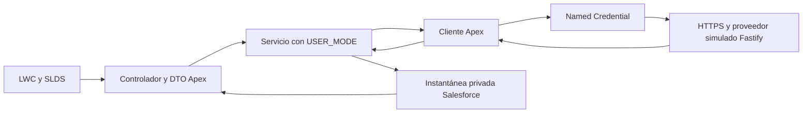

# P05 — Ficha técnica V1

**Implementación y diagnóstico completados; aceptación final pendiente.**
Proyecto de demostración con proveedor HTTP, catálogo y datos simulados; sin
clientes, tráfico de producción ni métricas de impacto empresarial atribuidas.

## Problema y funcionalidad

Permitir que un perfil comercial consulte una tarifa externa y conserve el resultado
original para su consulta posterior. Implementa selección de producto/cantidad,
validación estricta, guardado de una instantánea privada, detalle e histórico propio,
caducidad estimada y recuperación tras errores. El histórico funciona sin proveedor.
No incluye pedidos, pagos, impuestos, reservas ni sincronización automática de precios.

## Arquitectura y tecnologías

Node.js 24, TypeScript y Fastify 5; contrato OpenAPI 3.1 y validación Ajv en tests.
Apex, Product2, ConsultaTarifa__c, trigger de integridad, Custom Permission y tres
Permission Sets. LWC con DTO de nivel superior y SLDS. Pruebas Node, HttpCalloutMock
y Jest. Herramientas/versiones comprobadas por fase en [ENVIRONMENT](ENVIRONMENT.md).

## Decisiones técnicas

| Decisión | Motivo y alternativa descartada en este alcance |
| --- | --- |
| Precio calculado en el proveedor, céntimos enteros y cadenas decimales | Evita depender de precios o cálculos aportados por el navegador; sin Price Books ni lógica comercial adicional |
| Named/External Credential y principal restringido | Separa configuración protegida de Apex/LWC; sin claves incrustadas ni llamada directa del navegador |
| USER_MODE, filtro de propietario y contexto privado de inserción | Combina permisos reales con creación controlada; Create por sí solo no permite persistir datos arbitrarios |
| Instantánea inmutable con copias de nombre/código/importes | Conserva el resultado histórico; no representa una tarifa siempre actualizada |
| Hora Salesforce y avance monotónico para la vista | Evita usar el reloj de calendario del equipo; indica incertidumbre en lugar de prometer precisión absoluta |
| Instrumentación por entrada HTTP, separada de hooks/respuestas | Distingue callouts de recepciones; no añade deduplicación ni disimula el diagnóstico externo |

## Pruebas y demostración

- Fase 5: 40/40 Apex, 30/30 Jest y 43/43 proveedor; ocho componentes desplegados
  incrementalmente. Cifras históricas, no una ejecución nueva en fase 6.
- Recorrido comercial de demostración con perfil mínimo, guardado, detalle ajeno
  denegado, fallos seguros y lectura sin proveedor en fases 4–5.
- Fase 5B: 14 operaciones, seis callouts y 18 entradas HTTP; dos recepciones ante
  429/503 por callout Apex, con una en controles Node; tres pruebas locales afectadas.
- Cinco instantáneas conservadas al final de 5B. No son métricas de adopción ni carga.

[Matriz y evidencias concretas](ACEPTACION-V1.md) · [evidencia 5](evidencias-fase-5.json)
· [evidencia 5B](evidencias-fase-5b.json) · [captura limitada del histórico sin proveedor](evidencias/fase-5/detalle-sin-proveedor.png).

## Reproducción y límites

[Instalación y reproducción](INSTALACION.md), [guía de uso](USO.md) y
[conexión protegida](CONEXION.md). Instalación incremental demostrada; limpia
documentada y revisada estáticamente, sin ejecución desde cero.

No se garantiza entrega física única ni idempotencia entre acciones independientes.
La causa interna de las repeticiones externas sigue sin identificar. UI de escritorio,
histórico acotado, DateTime persistido en segundos y vigencia visual estimada.
Los controles de integridad no impiden a un administrador cambiar el código.

La [propuesta de aceptación](ACEPTACION-V1.md) delimita reintentos de aplicación y
transporte, y explicita el alcance de instalación. Ninguna de esas decisiones se
registra como aprobada; V1 no está cerrada.
